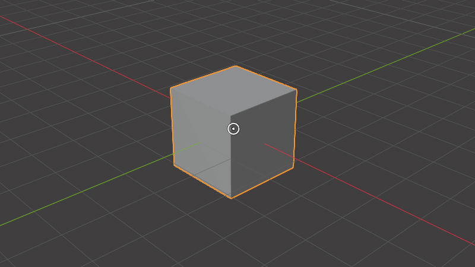
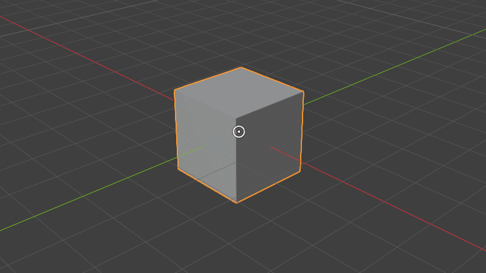

# Transform Indicator

A Blender add-on that shows where a move, rotate or scale started and how far it has gone, while you are doing it.

| Move | Rotate | Scale |
| --- | --- | --- |
|  |  |  |

- **Move:** a dashed line from the start point to the current position, labelled with the distance.
- **Rotate:** an arc from the start direction, labelled with the angle. Turns past 360° keep growing as a spiral.
- **Scale:** the start size as a dashed ring and the current size as a solid ring, labelled with the factor. A mirrored (negative) scale is drawn dashed.

Values use the scene's units: length units and degrees or radians.

## Requirements

Blender 4.2 or newer.

## Use

Press G, R or S in the 3D viewport, or start a transform from a menu or tool. The indicator appears in Object Mode, Mesh Edit Mode and Pose Mode.

- **Overlays popover:** the Transform Indicator panel has a master switch and a checkbox each for Move, Rotate and Scale.
- **Shift+Alt+T:** turns the indicator on or off. Rebind it under Preferences > Keymap > 3D View.

## Preferences

Edit > Preferences > Add-ons > Transform Indicator:

- **Capture on G/R/S:** records the exact start state when the key is pressed.
- **Detect Other Transforms:** also shows the indicator for transforms started from menus, tools, or other keys.
- **Show In:** Object Mode, Mesh Edit Mode, Pose Mode.
- **Show Values:** the distance, angle, and scale labels.
- **Start / Delta colors, Line Width, Radius:** appearance.

## Development

- `./release.sh [major|minor|patch]` bumps the version, builds `dist/transform_indicator-X.Y.Z.zip`, commits, tags `vX.Y.Z` and pushes.
- `docs/render_media.py` renders the images above headless with the add-on's own drawing code:
  ```
  BLENDER_USER_RESOURCES=<scratch dir with the add-on in extensions/user_default> \
    blender -b --factory-startup --python docs/render_media.py
  ```

## License

GPL-3.0-or-later.
